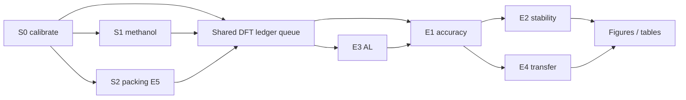

# Experiment plan (engine execution)

Concrete runbook derived from [`paper/OUTLINE.md`](../paper/OUTLINE.md) and [`paper/plan.md`](../paper/plan.md). Hypotheses **H1–H5** map to experiment bundles **E1–E6** and stages **S0–S6**. Code hooks: `aimd_mlff_methods.data.splits` (leakage-safe splits + manifests), `aimd_mlff_methods.validation.metrics` (accuracy + stability statistics), `aimd_mlff_methods.integrator` (reference/NVE checks).

**Engine (fixed):** 1× RTX 3060 12 GB, 32 CPU threads, 61 GB RAM, ~223 GB free disk. **No GPU rental.** GPU is time-shared with NCA/DenoiseOpt unless Julian elevates AIMD (see **D6**).

**Cross-cutting (every stage):**

| Requirement | Implementation |
|-------------|----------------|
| Resumable jobs | One directory per job: `status.json` (`phase`, `step`, `updated_at`), checkpoints every *N* MD steps / training epochs; idempotent restart from last checkpoint. |
| Data durability | After each job phase: `restic backup <datadir> --tag aimd_mlff` to Hetzner bucket (encrypted, **append-only** snapshots; never `forget` without explicit policy). |
| DFT accounting | Append-only **ledger** (CSV or SQLite): `call_id`, `system`, `composition`, `n_atoms`, `method/basis`, `cluster_id`, `wall_s`, `converged`, `seed`, `al_round` (nullable). Shared pool across AL strategies to avoid double labelling. |
| Statistics | ≥**3** independent **seeds** per compared condition; report **mean ± sample std** (`aggregate_over_seeds`); bootstrap 95% CIs on frame-level metrics (`energy_force_errors`). |
| Splits | **Trajectory block** groups for train/val/test within a composition (`split_by_trajectory_blocks`, 70/15/15 default). **Composition holdout** for transfer (`split_by_composition`). No frame-level leakage from correlated AIMD frames. |
| Reference dynamics | Unit-correct Verlet / ASE Langevin NVT; old prerun frames only as extra single-point labels, not as AIMD reference trajectories. |

**Compute assumptions (calibrated in S0; scale all DFT CPU-h if measured wall/label differs):**

| Parameter | Planning value | Notes |
|-----------|----------------|-------|
| DFT single-point (cluster 60–100 atoms, TZVP family) | **10 min** (range S0: 5–20 min) | Drives all label budgets. |
| DFT single-point (methanol 6-atom cluster / gas-phase sanity) | **2 min** | S1 only. |
| MACE train (3k frames, small model, 1 full fit) | **~2 GPU-h** | 3060, batch tuned to 12 GB. |
| NequIP train (same data) | **~4 GPU-h** | Slower; run overnight on GPU while DFT queues. |
| MPNN baseline (tutorial architecture) | **~0.5 GPU-h** | CPU-viable; deprioritize GPU. |
| MLFF MD | **~0.5 GPU-h / ns** for ~1k-atom NVT (rough) | Stability runs dominate GPU after labelling. |
| Short AIMD reference (few ps, small cell, for RDF/D) | **~50–200 CPU-h / system** | Parallelizable on threads; start early for H3c. |
| xTB MD presampling | **≪ DFT** | CPU; feeds AL only (not ground truth). |
| OpenMM densify / packing | **&lt;1 CPU-h / box** | H1; parallel with S1. |

**Parallelism strategy (finish fast, not “weeks on a Gantt chart”):**

- **Always overlap:** DFT worker pool on **all 32 threads** while **one** GPU job trains or runs MD (queue MACE/NequIP/MPNN serially on GPU).
- **Critical path (wall-clock):** `S0` → electrolyte **DFT label pool** (S3+S4 combined, ≤3k labels × 2 main systems) → **S4** (all model variants) → **S5** (1 ns × 3 seeds × 3 inits × top models) + **short AIMD** for H3c. Packing **S2** and methanol **S1** are off the critical path if started in parallel with S0.
- **Rough critical-path compute (if 10 min/label, 2 systems × 3k labels):** DFT **~1,000 CPU-h** (~31 thread-days of continuous CPU, ~**10–14 calendar days** at ~70% duty cycle with contention) + GPU **~120–180 GPU-h** for S4+S5 (queued behind NCA unless D6 grants priority).

---

## Systems (composition keys)

| ID | System | Role | Box scale (target) | Holdout use |
|----|--------|------|-------------------|-------------|
| **S1** | Methanol (gas / small cluster) | Tutorial sanity, integrator + pipeline | 6–30 atoms (DFT), optional 200-atom liquid box for packing only | In-distribution baseline |
| **S2** | LiClO₄ in acetonitrile (ACN) | Salt + organic liquid | ~1k atoms MD; DFT clusters 60–100 atoms around Li⁺ | **0.5 M and 2.0 M** held out for H5 |
| **S3** | EC:EMC + LiPF₆ (standard electrolyte) | Multi-component liquid | ~1k atoms MD; DFT clusters as above | **Alternate EC:EMC ratio** + **DMC** as unseen solvent (H5) |
| **S3′** | DMC-containing variant | Transfer stress test | Same as S3 | Never in training for H5 zero-shot |
| **Gold** | Optional “gold sample” from prior work | Only if Julian confirms (D4) | TBD | Legacy comparison |

Packing benchmarks (**H1**) use liquid boxes for **S1** (water/ethanol 50:50 proxy or methanol liquid if packed), **S2**, **S3** (~10 Å–nm scale per `paper/inventory.md` mond tutorial, scaled to ~1k atoms for stability).

---

## Model matrix (reused across hypotheses)

| Tag | Model | Training | Conservative? | Notes |
|-----|-------|----------|---------------|-------|
| **M0** | MACE-OFF | Fine-tune | Yes | Match DFT level to ωB97M-D3(BJ) where possible; **license D4**. |
| **M1** | MACE-MP-0 | Fine-tune | Yes | Li/P/F/Cl coverage; same label pool as M0. |
| **M2** | MACE | From scratch | Yes | 2×128 channels, L=1, r_cut 5 Å (tune in S0). |
| **M3** | NequIP | From scratch | Yes | Same data budget as M2. |
| **M4** | Force MPNN | From scratch | **No** | mlff-tutorial baseline; direct forces only. |

Optional **U0** (UMA zero-shot): report-only if **D4** + license allow; not in primary H2a comparison.

---

## Hypothesis experiments

### H1 — mond packing (RQ1) — **Experiment E5**

| Field | Specification |
|-------|----------------|
| **System** | Liquid boxes **S1, S2, S3** (post-mond OpenMM densify: ff14SB/TIP3P or GAFF/AM1-BCC for organics; match `mond` tutorial settings). |
| **DFT labels** | **None** for packing score (classical reference only). Optional ≤20 DFT points later for unrelated validation—not part of H1. |
| **Model** | N/A (packmol baseline + mond). |
| **Training / validation** | N/A. Compare to packmol on identical composition targets. |
| **Metric & refutation** | **Density** vs reference (experiment or 5 ns OpenMM NPT): error **&lt; 2%** pass. **Min distance** histogram: no pairs below **0.8× vdW** contact after densify. **Wall time** to finished box: mond **≤ packmol**. **Refuted** if any system fails density or overlaps, or mond slower than packmol. |
| **Seeds** | **3** random seeds for mond insertion order / initial poses; report mean ± std on density and time. |
| **Compute** | **~3–6 CPU-h** total (parallel across S1–S3). **0 GPU-h.** |
| **Dependencies** | **S0** (OpenMM/packmol on PATH); **mond** upstream fix preferred (**D7**). Can run parallel to S1. |
| **Paper output** | **Table 1** (packing metrics); **Figure 1** (density error bars + min-distance histograms). |

---

### H2a — Foundation fine-tunes beat scratch (RQ2) — **Experiments E1, E6 (partial)**

| Field | Specification |
|-------|----------------|
| **System** | **S2, S3** primary; **S1** secondary sanity. |
| **DFT labels** | **≤ 3,000** single-point clusters per system (shared pool for all models). Level: **ωB97M-D3(BJ)/def2-TZVPPD** (or **D2** fallback with re-labelling plan). Clusters 60–100 atoms, carved around Li⁺ or high-uncertainty atoms. |
| **Model** | Compare **M0, M1** vs **M2, M3** at **identical** label sets and splits. |
| **Training / validation** | Split: `split_by_trajectory_blocks` on AIMD/xTB trajectories that produced candidates; val for early stopping; **test** = held-out blocks. Train: MACE/NequIP defaults + energy/force loss schedule per `paper/plan.md`. Evaluate: `energy_force_errors` on test frames; primary endpoint **force RMSE**; secondary force MAE, energy MAE. |
| **Metric & refutation** | Per system: ΔRMSE = RMSE(scratch) − RMSE(foundation) across seeds. **Pass H2a** if bootstrap 95% CI for ΔRMSE **excludes 0** and foundation **lower** (M0 or M1 wins vs both M2 and M3) for **≥2/2** main systems. **Refuted** if CI includes 0 or scratch wins on both S2 and S3. |
| **Seeds** | **≥3** training seeds per model × system; aggregate mean ± std; CIs from frame bootstrap. |
| **Compute (per system)** | DFT **~500 CPU-h** (3k × 10 min); GPU **~6×3 = 18 GPU-h** (M0,M1,M2,M3 × 3 seeds, overlaps with DFT). |
| **Dependencies** | **S0** timing; **labelling PR-A** + ledger; splits/metrics merged; label pool before any training. |
| **Paper output** | **Figure 2a** (force RMSE vs label count if learning curve shared with H4); **Table 2** (E1 accuracy grid). E6 ablation: same table, restricted to M0 vs M2 only. |

---

### H2b — Conservative E→F beats direct MPNN (RQ2) — **Experiments E1, E6 (partial)**

| Field | Specification |
|-------|----------------|
| **System** | **S1, S2, S3**. |
| **DFT labels** | Same pools as H2a (**≤3k** / system). |
| **Model** | **M4** (MPNN) vs best conservative from H2a (**M0** or **M2** per system). |
| **Training / validation** | Same splits as H2a. MPNN: force-only MSE (tutorial), rotation aug. Conservative: full energy+force. Metrics: `energy_force_errors` on test set. |
| **Metric & refutation** | **Pass** if conservative model has **lower** force MAE **and** energy MAE on test, each with bootstrap CI not overlapping worse tail, **≥2/3** systems. **Refuted** if MPNN wins on both MAEs for majority of systems. |
| **Seeds** | **≥3** per model. |
| **Compute** | Marginal **+1.5 GPU-h** per system (M4 cheap); no extra DFT if same pool. |
| **Dependencies** | H2a label pool + splits. |
| **Paper output** | **Figure 2b** (paired MAE scatter); **Table 2** column block for M4. |

---

### H3a — Long NVT stability (RQ3) — **Experiment E2**

| Field | Specification |
|-------|----------------|
| **System** | **~1k-atom** boxes **S2, S3** (liquid), 298 K NVT (ASE Langevin). |
| **DFT labels** | None new; uses models from **S4/H2**. |
| **Model** | Top **2** conservative models from H2a per system (+ **M4** for contrast in E6). |
| **Training / validation** | Stability protocol only: `time_to_failure` with bond break, **T &gt; 2×T₀**, energy blow-up rules (see `validation.metrics`). |
| **Metric & refutation** | **1 ns** target per run. **Pass** if **≥8/9** runs succeed (3 seeds × 3 Maxwellian inits) per model/system. **Refuted** if **&lt;8/9** for the claimed “best” model. |
| **Seeds** | **3** model seeds × **3** velocity reinitializations (9 runs). |
| **Compute** | **~9 × 0.5 GPU-h ≈ 4.5 GPU-h** per model per system (1 ns); ×2 models ×2 systems ≈ **36 GPU-h** (critical path tail). |
| **Dependencies** | Trained checkpoints from **S4**; mond boxes; integrator/sampling drivers. |
| **Paper output** | **Figure 3a** (Kaplan–Meier-style time-to-failure); **Table 3** (failure counts). |

---

### H3b — NVE energy drift (RQ3) — **Experiment E2 + E6**

| Field | Specification |
|-------|----------------|
| **System** | Same equilibrated NVT structures as H3a; switch to **NVE** microcanonical segments (≥50 ps). |
| **DFT labels** | None. |
| **Model** | Best conservative vs **M4**. |
| **Training / validation** | `run_nve` / merged integrator; `nve_energy_drift_mev_per_atom_ps` on total energy. |
| **Metric & refutation** | **Pass:** drift **&lt; 1 meV/atom/ps** for conservative; conservative **&lt; M4** drift (mean over seeds). **Refuted** if conservative ≥1 meV/atom/ps or drift ≥ MPNN. |
| **Seeds** | **≥3** (inherit from H3a inits). |
| **Compute** | **~5 GPU-h** per system (included in H3a wall time if back-to-back). |
| **Dependencies** | H3a equilibrated states. |
| **Paper output** | **Figure 3b** (drift distributions); E6 inset MPNN vs MACE. |

---

### H3c — Structural/kinetic fidelity vs AIMD (RQ3) — **Experiment E2**

| Field | Specification |
|-------|----------------|
| **System** | **S2, S3** (Li⁺ environments); short **AIMD** reference trajectories (same DFT level, small periodic or cluster cell—**D3**). |
| **DFT labels** | **~200–500** frames × short AIMD (few ps each); separate from AL pool. **~33–83 CPU-h** if 10 min/frame equivalent (often cheaper per step—budget **100 CPU-h/system**). |
| **Model** | Best conservative from H2a. |
| **Training / validation** | `compare_radial_distribution` (O–H, C–O, Li–O pairs); `diffusion_coefficient_from_msd` + `compare_diffusion_coefficients`; Li⁺ **CN** from RDF integral or explicit shell count. |
| **Metric & refutation** | RDF ∫\|Δg\|dr **&lt; 0.1**; **D** within **30%** of AIMD; Li⁺ CN within **±0.5**. **Refuted** if any fails on both systems. |
| **Seeds** | **≥3** AIMD inits × **3** MLFF continuations. |
| **Compute** | AIMD **~100 CPU-h/system**; analysis **CPU-only**. |
| **Dependencies** | Start AIMD early (parallel to S4 GPU). DFT backend **D1**. |
| **Paper output** | **Figure 4** (RDF overlays); **Table 3** (D, CN). |

---

### H4 — Active learning efficiency (RQ4) — **Experiment E3**

| Field | Specification |
|-------|----------------|
| **System** | **S2, S3** (one AL campaign per system, shared label pool). |
| **DFT labels** | Budget cap **≤3,000** per system; strategies stop when val force RMSE plateaus or budget exhausted. |
| **Model** | **M2** (MACE scratch) as learner; **4-model committee** (QBC) + single-model uncertainty (Zaverkin); baselines: **random** frame pick, **uncorrelated MD snapshot** stratified sampling. |
| **Training / validation** | xTB MD presampling → propose candidates → ledger DFT → retrain; val split fixed from `split_by_trajectory_blocks`. Track **area under learning curve** (RMSE vs cumulative DFT calls). |
| **Metric & refutation** | **Pass** if QBC **or** uncertainty AL reaches H2a target RMSE and H3a stability threshold with **≥2×** fewer DFT calls than both baselines (ratio CI excludes 1), **≥3** seeds. **Refuted** if ratio **&lt;2** or CI overlaps 1. |
| **Seeds** | **≥3** AL seeds (committee init + candidate shuffle). |
| **Compute** | Same **~500 CPU-h** DFT cap/system (shared with S4—**do not double-label**); **+30 GPU-h**/system for intermittent retrains. |
| **Dependencies** | **S0** xTB speed; **PR-C** AL orchestrator; ledger; MACE training pipeline. |
| **Paper output** | **Figure 5** (learning curves + DFT call counts); **Table 4** (AUC and call ratios). |

---

### H5 — Composition transfer (RQ5) — **Experiment E4**

| Field | Specification |
|-------|----------------|
| **System** | **Held-out compositions:** S2 **0.5 M & 2.0 M** (train on other concentrations); S3 **alternate EC:EMC**; **S3′ DMC** unseen. |
| **DFT labels** | **Zero-shot:** none new. **Recovery:** **≤50** labels per holdout (ledger-logged). |
| **Model** | Best **M0/M2** from in-distribution training. |
| **Training / validation** | `split_by_composition` for holdouts; test force RMSE on holdout frames; optional fine-tune on ≤50 labels then re-test H3a on short NVT. |
| **Metric & refutation** | Zero-shot RMSE **≤ 1.5×** in-distribution RMSE; after ≤50 labels, match in-distribution RMSE (CI overlap) **and** H3a **≥8/9** short runs. **Refuted** otherwise. |
| **Seeds** | **≥3**. |
| **Compute** | **~25 CPU-h** holdout labelling; **~10 GPU-h** fine-tune + stability. |
| **Dependencies** | **S4** base models; composition manifest. |
| **Paper output** | **Figure 6** (transfer bar chart); **Table 5**. |

---

## Stage index (execution bundles)

| Stage | Hypotheses | Primary experiments | CPU-h (order) | GPU-h (order) |
|-------|------------|---------------------|---------------|---------------|
| **S0** | — | Calibration, licence smoke tests | 8–24 | 2–4 |
| **S1** | H2b (sanity) | Methanol E1 mini | 20–50 | 4–8 |
| **S2** | **H1** | **E5** packing | 3–6 | 0 |
| **S3** | **H4** | **E3** AL | 500–1000 / sys | 30 / sys |
| **S4** | **H2a, H2b** | **E1, E6** | (shared pool) | 40–60 |
| **S5** | **H3a–c** | **E2** | 200–400 | 40–80 |
| **S6** | **H5** | **E4** | 50–100 | 10–20 |

---

## Licence and compliance (read before S0)

| Asset | Issue | Action |
|-------|-------|--------|
| **MACE-OFF** | Academic / **non-commercial** license | Confirm Julian’s use (academic paper + engine) qualifies (**D4**). |
| **MACE-MP-0** | Check current terms on download | Log acceptance in experiment metadata. |
| **UMA / fairchem** | **Gated** weights + license | **U0** only after explicit approval; do not wget weights in CI. |
| **ORCA** | Commercial if real binary | Confirm **D1**; do not assume `/usr/bin/orca`. |

---

## Decisions for Julian

Check one option per item (or add a short note). Defaults in **bold** are the authors’ recommendation for fastest valid paper path on the engine.

### D1 — DFT engine

- [ ] **A. Psi4 via user-space micromamba** (no root) — **recommended** if S0 shows ≤15 min/label on 80-atom clusters and ωB97M-D3 available.
- [ ] B. PySCF (+ **gpu4pyscf** on 3060 for integrals) — recommended if Psi4 install fails or is slower on clusters.
- [ ] C. **ORCA** (licensed) — recommended only if Julian has a verified license and binaries not the GNOME `orca` shim.

### D2 — DFT labelling level

- [ ] **A. ωB97M-D3(BJ)/def2-TZVPPD** (aligns with MACE-OFF) — **recommended** for publication-facing numbers.
- [ ] B. ωB97X-D/def2-TZVP — recommended fallback if A is &gt;2× slower with similar chemistry.
- [ ] C. def2-SVP inner loop only — recommended **only** for AL prescreening with mandatory relabelling subset at A.

### D3 — Cluster vs periodic DFT

- [ ] **A. Finite clusters (non-periodic), no wrapping** — **recommended** for CPU budget and engine constraints; disclose in §6 Limitations.
- [ ] B. Periodic DFT (CP2K/QE) for a **subset** — recommended only if Julian requires bulk liquid RDF/CN at full periodicity (adds **~3–10×** CPU-h).

### D4 — Systems and optional gold sample

- [ ] **S1 methanol** — recommended **yes**
- [ ] **S2 LiClO₄/ACN** — recommended **yes**
- [ ] **S3 EC/EMC/LiPF₆** — recommended **yes**
- [ ] **DMC held out (S3′)** — recommended **yes** for H5
- [ ] **Gold sample** from prior engine work — recommended **no** unless a specific composition is identified (inventory found none in git)

### D5 — Models outside git

- [ ] **None known** (inventory: only PyG MPNN in mlff-tutorial) — recommended unless Julian lists local notebooks/checkpoints.
- [ ] Other attempts exist: _______________

### D6 — GPU priority vs NCA / DenoiseOpt

- [ ] **AIMD gets preemptive priority** on 3060 during S4–S5 — **recommended** for critical-path MD (accept slower NCA jobs).
- [ ] Share fairly (50/50) — recommended only if NCA deadline conflicts.
- [ ] NCA priority — not recommended for this paper timeline.

### D7 — mond Verlet fix upstream

- [ ] **Merge mond fix upstream** (`cap-jmk-real/mond`) and pin release — **recommended** before S1/S2; drop vendored copy in mlff-tutorial when tagged.
- [ ] Keep vendored mond from mlff-tutorial PR #15 only — acceptable short-term for S0–S1.

---

## Figure / table map (summary)

| Output | Hypothesis | Primary data |
|--------|------------|--------------|
| Table 1, Fig 1 | H1 | E5 packing |
| Table 2, Fig 2 | H2a, H2b | E1, E6 |
| Table 3, Fig 3 | H3a, H3b | E2 |
| Fig 4 | H3c | E2 + AIMD |
| Table 4, Fig 5 | H4 | E3 |
| Table 5, Fig 6 | H5 | E4 |

---

## Immediate next steps (after this PR merges)

1. Julian completes **D1–D7** (checkboxes above).
2. Land **PR-A** (labelling + ledger) and wire `restic` hook in **PR-E** `run_stage.sh`.
3. Run **S0** once; rescale CPU-h/GPU-h columns in this file from measured `wall_s` in the ledger.
4. Launch **S2 ∥ S1 ∥ DFT pool** on day 1 of execution.
